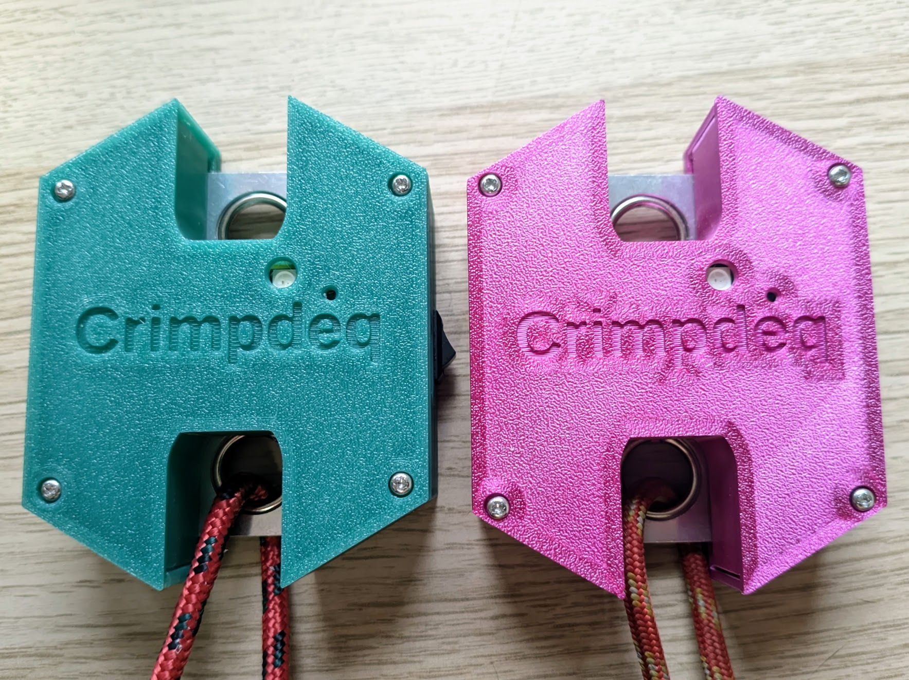
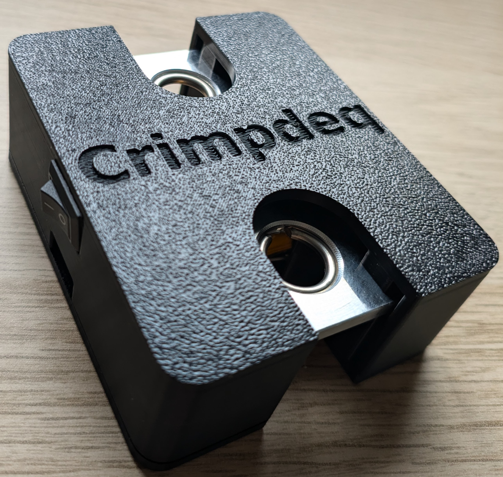

# Crimpdeq 3D Case

OpenSCAD source files for the Crimpdeq 3D-printable enclosure (main body + lid), including assembly models and collision checks used in CI.



*V3 case*



*V1 and V2 case*

This branch holds a new case for the [crimpdeq-tscircuit](https://github.com/crimpdeq/crimpdeq-tscircuit)
board (ADS1220 variant). It has not been printed or released yet; the photos show the earlier cases.

## Print the case

Download `case_main.stl` and `case_lid.stl` from the release that matches your PCB revision
(see [Compatibility](#compatibility)). Releases up to `v3.1.0` ship the STLs in assembly
orientation, so lay the lid on its outer face before slicing; later releases ship them in print
layout. From `v3.1.0`, releases also include `crimpdeq-case.3mf`, a Bambu Studio project with
both parts laid out and the [print settings](#build-the-bambu-studio-project) applied. The V3
and tscircuit parts need no support.

To assemble the V3 case, follow the [Crimpdeq book](https://book.crimpdeq.com/assembly/crimpdeq/index.html).

## Compatibility

Use the case release in the row for your PCB revision. From V2 on, the case and PCB share the
major version; PCB V1 uses case `v0.4.0`.

| Case                                                                      | PCB                                                                    |
| ------------------------------------------------------------------------- | ---------------------------------------------------------------------- |
| This branch (unreleased)                                                  | [crimpdeq-tscircuit](https://github.com/crimpdeq/crimpdeq-tscircuit)   |
| [`v3.1.0`](https://github.com/crimpdeq/crimpdeq-case/releases/tag/v3.1.0) | V3 ([`v3.0.0`](https://github.com/crimpdeq/crimpdeq-pcb/releases/tag/v3.0.0)) |
| [`v2.0.0`](https://github.com/crimpdeq/crimpdeq-case/releases/tag/v2.0.0) | V2 ([`v2.0.0`](https://github.com/crimpdeq/crimpdeq-pcb/releases/tag/v2.0.0)) |
| [`v0.4.0`](https://github.com/crimpdeq/crimpdeq-case/releases/tag/v0.4.0) | V1 ([`v1.0.1`](https://github.com/crimpdeq/crimpdeq-pcb/releases/tag/v1.0.1)) |

## Components

- [crimpdeq-tscircuit](https://github.com/crimpdeq/crimpdeq-tscircuit) PCB, 17 × 31.5 mm
- [603040 800 mAh battery](https://es.aliexpress.com/item/1005010306922880.html), 6 × 30 × 42 mm with its protection board
- [KCD11 switch](https://www.aliexpress.us/item/2255800787248498.html), the same 10 × 15 mm part as in V3
- Load cell from this [crane scale](https://www.aliexpress.com/item/1005002719645426.html)
- Four M2.5×10 thread-forming screws

## Design

The case is 90 × 58 × 25 mm (V3: 97.1 × 77.4 × 30.6 mm): flat front, rear and end walls with
45° chamfers, symmetric about its short axis. Everything stacks over the load cell:

- The load cell goes in with its strain-gauge cover facing the floor and its wires toward the
  front. Four floor pads hold the plate 0.5 mm above the cover, and its wires run under the
  plate. The two rear notches drop over the rear screw posts, which hold the plate sideways and
  backwards; low ribs in front of it stop it moving forward.
- The battery lies flat on the plate's bare top face, protection-board end forward. Turn it
  over so its leads leave the right corner; they bend forward in a 2.5 mm gap beside it. Lid
  bars beside the board stop 0.3 mm above the battery: they keep it off the board's bottom parts
  without pressing it onto the load cell, which would shift the reading.
- The board sits over the battery, top side up and unrotated, so the ESP32 module, the USB-C
  connector and both LEDs face the lid. Its wire-pad end hangs 10.1 mm in front of the battery,
  so every wire reaches its pad from below with room for the solder joint.

Each eye stays reachable through an isolated vertical U-slot that runs out through the case end,
with 2.5 mm of clearance around the eye; on its inboard side the slot stops at the battery bay
wall. The slot exits 19.5 mm from the eye center (V3: 23 mm). The end walls carry a groove for
each lid slot-wall end, so the gap round it is a labyrinth.

The board rests on two fingers on a floor column, on the bare strips between each wire-pad
column and the USB-C shell legs. A lid pad presses the flat top of the USB-C shell, right above
them, by a one-layer (0.1 mm) preload. The front screw posts guide the board's long edges, and
chamfered lid tabs behind its rear edge take USB-C insertion loads. The receptacle sits in a
front-wall opening that runs out through the top of the main body, so the board drops straight
in. A 13.65 × 7.8 mm overmold pocket lets a cable's molded overmold (up to the 12.85 × 7.0 mm
maximum in the USB Type-C plug dimensions update) reach within 0.3 mm of the receptacle face; it
runs out through the lid as a notch.

The KCD11 sits in the front wall right of the USB-C connector, over the load cell's front-right
corner and beside the battery leads. A collar behind the wall grips its bezel over 3 mm. Its
wires turn up behind the solder joints, run over the battery beside the board, forward and down
to the SW pads. The column sits between the J3 and J4 wire-pad columns, and lanes beside it, inside
the front posts, carry the load-cell, battery and switch wires to their pads.

The rear screws stand in the load cell's rear notches and the front screws flank the board;
each pilot is 5.25 mm inside the outer faces, as in V2, and countersunk 0.6 mm. Every lid
feature over the load cell stops 0.6 mm above it.

The ESP32 antenna sits over the battery, as in V3. The checks do not cover RF, fit or strength
on printed parts.

## Requirements

- `openscad` (CLI and/or GUI)
- `bash`
- Optional for headless Linux runs: `xvfb-run` (the collision script uses it automatically when no `DISPLAY` is available)

## Quick Start

### Preview in OpenSCAD (GUI)

Open the main files directly:

```bash
openscad case/case_main.scad
openscad case/case_lid.scad
openscad case/assembly.scad
```

### Export STL files (CLI)

```bash
openscad -o case/case_main.stl case/case_main.scad
openscad -o case/case_lid.stl case/case_lid.scad
```

By default, both files export in assembly orientation:
- `case_main.scad`: main body in assembled orientation
- `case_lid.scad`: lid in assembled orientation

To export in print layout instead:

```bash
openscad -D 'print_layout=true' -o /tmp/case_main_print_layout.stl case/case_main.scad
openscad -D 'print_layout=true' -o /tmp/case_lid_print_layout.stl case/case_lid.scad
```

Print layout places:
- `case_main.scad`: upright with the floor on the build plate (`Z=0`)
- `case_lid.scad`: flipped so the outer top face is on the build plate (support-free)
- Neither part needs support

### Build the Bambu Studio project

```bash
python3 scripts/export-bambu-project.py
```

This writes `exports/crimpdeq-case.3mf` (gitignored): both parts in print
layout on one plate, set up for a Bambu Lab A1 with a 0.4 mm nozzle, Generic
PLA and the textured PEI plate. The script slices the plate to confirm it is
printable. If `bambu-studio` on `PATH` is a wrapper script, point
`BAMBU_STUDIO` at the real executable, for example
`BAMBU_STUDIO=/opt/bambustudio-bin/AppRun` on Arch.

| Setting | Value |
|---|---|
| Layer height | 0.2 mm |
| Walls | 6 (solid 2.4 mm shell) |
| Top/bottom layers | 6 (solid floor and lid) |
| Infill | 20% |
| Supports | None |
| Brim | None |

### Run collision checks

This validates expected contacts/clearances between the enclosure parts and the internal components, including load-cell pads, notch posts and front stops, load-cell corner coverage, loaded and tilted carabiner clearance, vertical drop-in paths for the load cell, battery and PCB, lid clearance over a load cell resting 0.5 mm high, a lid that seats anywhere within its screw play, no straight path from the carabiner slots into the bay, the battery's stops and hold-downs, the PCB fingers, edge guides and play, the USB-C shell clamp preload and its seat on the shell, lid rear stops, the switch opening's grip length, switch, battery and load-cell wire routes to the cable pads, screw pilot depth, a fully mated USB-C cable with its overmold seated in the front-wall pocket, and separate lid view holes for the battery-status and RGB LEDs.

```bash
bash scripts/check-collisions.sh
```

Useful overrides for faster/local runs:

```bash
CHECK_JOBS=4 OPENSCAD_RENDER_FN=24 bash scripts/check-collisions.sh
```

- `CHECK_JOBS`: number of OpenSCAD checks to run in parallel (defaults to up to 4 cores)
- `OPENSCAD_RENDER_FN`: tessellation used by collision checks only (defaults to `24`)

## Project Structure

- `case/case_main.scad`: main enclosure body
- `case/case_lid.scad`: lid
- `case/assembly.scad`: internal assembly (load cell, battery, PCB, switch), shared with the checks
- `case/placement.scad`: derived assembly coordinates and shared outlines
- `case/collision_check.scad`: geometry intersections used for automated collision checks
- `case/dimensions.scad`: shared dimensions and clearances
- `scripts/check-collisions.sh`: CI/local collision validation script
- `scripts/export-bambu-project.py`: Bambu Studio project with the print settings

## CI and Releases

- `.github/workflows/cad_ci.yml`
  - Runs collision checks
  - Builds `case_main.stl` and `case_lid.stl`
  - Uploads STL artifacts for CI runs
- `.github/workflows/release.yml`
  - Builds the release STL files in print layout and `crimpdeq-case.3mf` when a GitHub Release is created
  - Uploads them to the release assets

## License

This repository is source-available for personal and educational use only.

Commercial manufacture, sale of PCBs, sale of 3D-printed cases, kits, or assembled Crimpdeq devices requires prior written permission.
